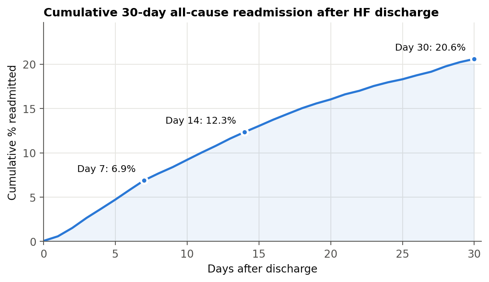
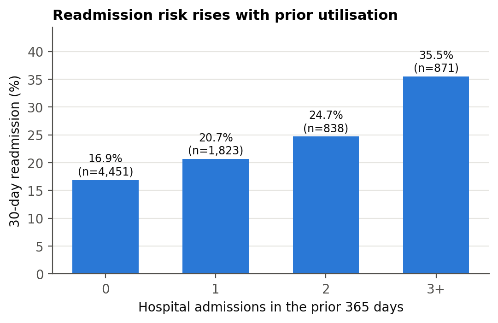
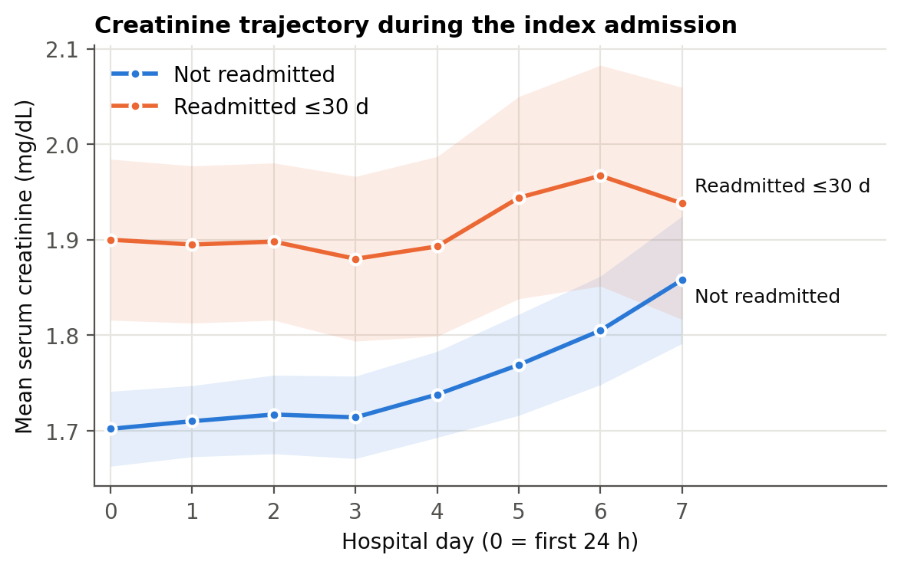
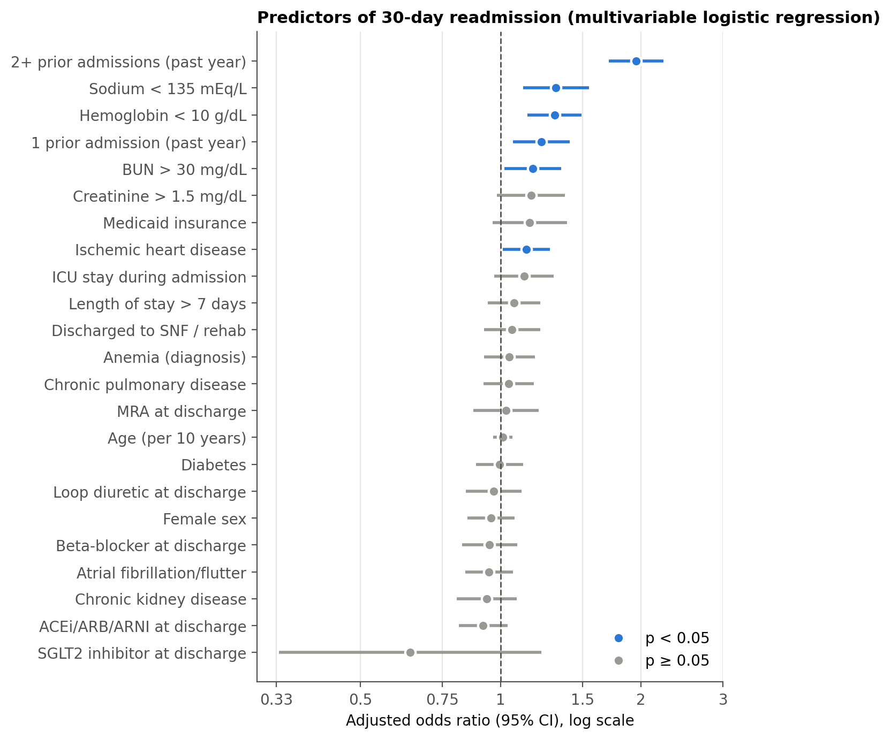
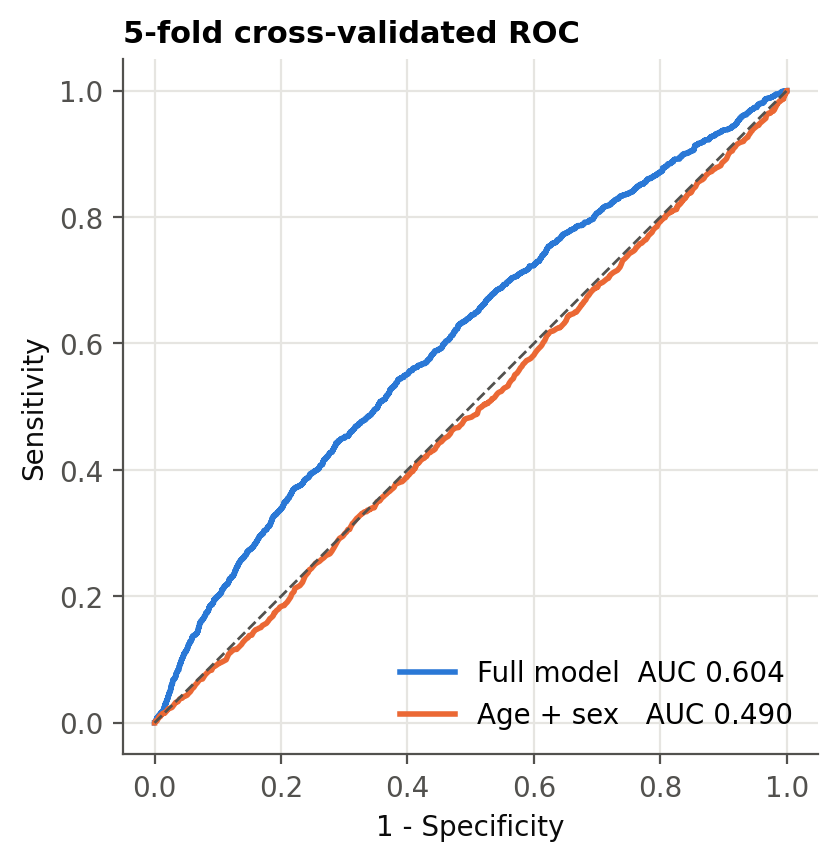
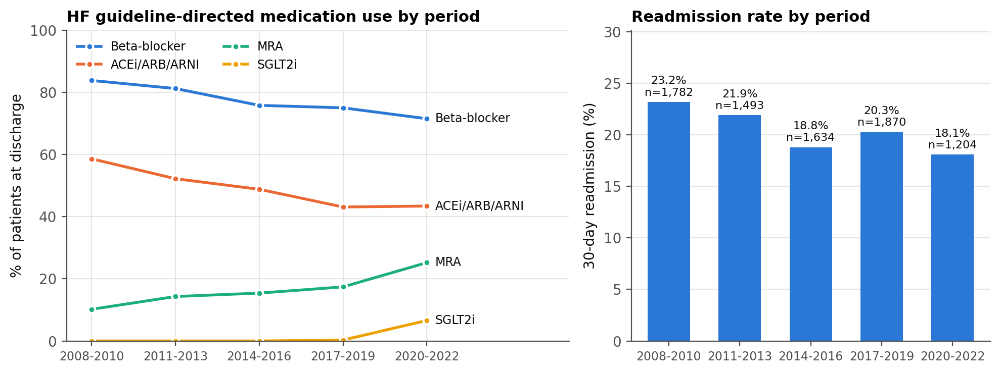

# Predicting 30-Day Readmission After Heart Failure Hospitalization: Integrating MIMIC-IV with ICD, LOINC and RxNorm/ATC Using SQL and Python

BIS 638 Final Project Report

---

## Abstract

**Background.** About one in five patients hospitalized for heart failure (HF) is readmitted
within 30 days. To study this outcome, a researcher must join admissions, diagnoses, labs and
medications that live in separate tables and use different coding systems.
**Methods.** We built a layered SQL data mart (staging → vocabulary → cohort → star schema) over
MIMIC-IV v3.1 in DuckDB. Diagnoses were standardized with ICD-9-CM/ICD-10-CM value sets, labs with
LOINC, and free-text drug names were mapped to WHO-ATC classes through the NLM RxNorm/RxClass API.
SQL window functions defined the index admission, readmission, prior utilization and lab time series.
Python was used for multivariable logistic regression and cross-validated prediction.
**Results.** Of 15,083 admissions with a principal HF diagnosis, 7,983 patients formed the index
cohort (mean age 73.6; 47.6% female). The 30-day all-cause readmission rate was **20.6%**
(1,644 patients). One third of these readmissions occurred within the first 7 days (6.9% of the cohort).
The strongest independent predictor was ≥2 admissions in the prior year (adjusted OR **1.95**, 95% CI 1.71–2.23).
Hyponatremia (OR 1.31), hemoglobin < 10 g/dL (OR 1.30), BUN > 30 mg/dL (OR 1.17) and ischemic heart
disease (OR 1.14) were also significant. The model's cross-validated AUC was **0.604** (95% CI 0.589–0.619)
versus 0.490 for age and sex alone. Readmission fell from 23.2% (2008–2010) to 18.1% (2020–2022)
while MRA and SGLT2-inhibitor use rose.
**Conclusion.** Integrating EHR data with standard terminologies and an external drug ontology
in a reproducible SQL pipeline reproduces known HF readmission epidemiology. It also shows that
structured EHR data alone gives only modest discrimination.

---

## 1. Introduction

HF readmissions are costly and are targeted by the CMS Hospital Readmissions Reduction Program.
Published 30-day readmission rates are about 20–25%, and EHR-based risk models typically reach
AUCs of 0.60–0.70. This project asks four questions:

1. What is the 30-day readmission rate after HF discharge in MIMIC-IV, and when do readmissions occur?
2. Which factors are independently associated with readmission?
3. How well does an interpretable model built from the integrated data discriminate readmitted from
   non-readmitted patients?
4. How did readmission and guideline-directed medical therapy (GDMT) change between 2008 and 2022?

The project's main technical contribution is the **integration** step. The same clinical concept
has to be recognized across several coding systems:

* HF and comorbidities are coded in **ICD-9-CM** (before Oct 2015) and **ICD-10-CM** (after).
* Labs use local MIMIC `itemid`s, which we map to **LOINC**.
* Medications are free text (e.g. "Metoprolol Succinate XL", "Sacubitril-Valsartan (24mg-26mg)").
  We map them to **RxNorm** ingredients and then to the **ATC** class hierarchy.

## 2. Methods

### 2.1 Data source
MIMIC-IV v3.1 (`hosp` and `icu` modules): 546,028 hospital admissions at Beth Israel Deaconess
Medical Center, 2008–2022. All dates are shifted. We recover an approximate real calendar year as
`anchor_year_group start + (admission year − anchor_year)`.

### 2.2 Database design
The pipeline is organized as four schemas (Figure in README §5):

| Schema | Contents | Design idea |
|---|---|---|
| `stg` | Source tables; large files (`labevents` 2.6 GB, `prescriptions`) are views over the compressed CSVs | Staging layer; no duplication of raw data |
| `vocab` | `concept_map` (ICD value sets), `concept_code` (expanded codes), `lab_concepts` (itemid→LOINC), `drug_class_targets` (ATC prefixes) | Knowledge layer kept separate from data, so definitions are editable CSVs |
| `cohort` | `adm_sequence`, `hf_admissions`, `index_adm`, `flow` | Cohort logic |
| `dw` | `dim_patient`, `dim_concept`, `dim_lab`, `dim_drug_class`, `map_drug_class`, `fact_diagnosis`, `fact_lab`, `fact_medication`, `fact_index_admission` | Star-schema data mart; grain = one index admission |

Key SQL techniques:

| Need | SQL technique |
|---|---|
| Next admission after discharge | `LEAD(admittime) OVER (PARTITION BY subject_id ORDER BY admittime)` |
| Admissions in prior 365 days | `COUNT(*) OVER (... RANGE BETWEEN INTERVAL 365 DAY PRECEDING AND INTERVAL 1 SECOND PRECEDING)` |
| First HF admission per patient | `QUALIFY ROW_NUMBER() OVER (PARTITION BY subject_id ORDER BY admittime) = 1` |
| Last lab before discharge | `ROW_NUMBER() OVER (PARTITION BY hadm_id, lab_name ORDER BY charttime DESC)` |
| Comorbidity / medication flags | `PIVOT ... ON concept_id USING COUNT(*)` |
| Cumulative readmission curve | `SUM(n) OVER (ORDER BY day)` over a generated `range(0,31)` calendar |
| ICD hierarchy expansion | `JOIN d_icd_diagnoses ON icd_code LIKE code_prefix || '%'` |

### 2.3 Terminology and ontology integration
* **ICD-9/ICD-10 value sets.** Eight concepts are defined by 59 code prefixes across both ICD versions:
  HF, diabetes, CKD, chronic pulmonary disease, AF, ischemic heart disease, anemia and obesity.
  Using the ICD hierarchy, these prefixes expand to **1,006 ICD codes**.
  Coding was balanced across versions: 3,867 index admissions were coded in ICD-9 and 4,116 in ICD-10.
* **LOINC.** Six labs were mapped from MIMIC `itemid`s: creatinine 2160-0, sodium 2951-2, BUN 3094-0,
  hemoglobin 718-7, potassium 2823-3 and NT-proBNP 33762-6. Creatinine, sodium, BUN, hemoglobin and
  potassium were present for 96–98% of index admissions; NT-proBNP for only 20.1%, so it was used
  descriptively.
* **RxNorm → ATC (NLM RxNav).** We mapped each drug string ordered at least 5 times in the discharge
  window (669 strings) as follows:
  `approximateTerm` → RxCUI → `related?tty=IN` (ingredients) → `rxclass/byRxcui?relaSource=ATC`.
  Of the 669 strings, **598 (89%)** resolved to at least one ATC class. Target classes were selected
  by ATC prefix:
  * loop diuretics C03C
  * beta-blockers C07
  * ACEi/ARB/ARNI C09A–C09D
  * MRAs C03DA
  * SGLT2i A10BK

  In total, 36 distinct drug strings fell into these classes. Two refinements came directly from
  inspecting the ontology output:
  * aliskiren (C09XA, a renin inhibitor) was excluded by narrowing C09 to C09A–D;
  * timolol eye drops share the C07 ingredient class, so eye/topical routes were excluded.

### 2.4 Cohort
* Inclusion: admissions with a principal (`seq_num = 1`) HF diagnosis
  (ICD-9 428.x, 402.x1, 404.x1/x3; ICD-10 I50.x, I11.0, I13.0, I13.2).
* Exclusion: in-hospital death, discharge to hospice, discharge against medical advice, age < 18.
* The first eligible admission per patient was taken as the index admission.

| Step | n |
|---|---|
| All MIMIC-IV hospital admissions | 546,028 |
| Admissions with principal diagnosis of HF | 15,083 |
| Distinct patients with ≥1 HF admission | 8,437 |
| **Index admissions after exclusions** | **7,983** |

### 2.5 Variables and outcome
* **Primary outcome:** any admission within 30 days of index discharge.
* **Secondary outcome:** death within 30 days (`patients.dod`).
* **Discharge medications:** orders active during the final 24 h of the stay.
* **Abnormal labs:** last value before discharge; a missing value was treated as not abnormal.

### 2.6 Statistics
* Table 1 compares groups with Mann-Whitney U (continuous) and χ² (categorical) tests.
* Multivariable logistic regression (statsmodels) reports adjusted ORs with 95% CIs.
* Discrimination is the 5-fold stratified cross-validated AUC (scikit-learn), with a
  500-replicate bootstrap 95% CI.
* The full pipeline reruns in about 1 minute (cached) or about 3 minutes from scratch, and
  results are identical across runs.

## 3. Results

### 3.1 Cohort and outcome
* **Patients:** median age 75 years [IQR 65–85]; 47.6% female; median length of stay 4.9 days.
* **Comorbidities:** ischemic heart disease 52.1%, AF 47.3%, diabetes 45.0%, CKD 44.5%.
* **30-day readmission:** 1,644 patients (**20.6%**).
* **30-day death:** 3.2%.
* **Readmission or death:** 22.5%.

**Timing (Figure 1).** Readmission risk is front-loaded: 6.9% of patients were readmitted by day 7,
12.3% by day 14, and 20.6% by day 30.

### 3.2 Unadjusted comparisons (Table 1, selected)

| Variable | Not readmitted (n=6,339) | Readmitted (n=1,644) | p |
|---|---|---|---|
| Age, median [IQR] | 75 [64–85] | 75 [65–85] | 0.82 |
| ≥2 admissions in prior year | 18.8% | 31.4% | <0.001 |
| CKD | 43.2% | 49.5% | <0.001 |
| Anemia (diagnosis) | 34.9% | 41.8% | <0.001 |
| Last creatinine > 1.5 mg/dL | 31.3% | 39.7% | <0.001 |
| Last hemoglobin < 10 g/dL | 30.5% | 42.3% | <0.001 |
| ACEi/ARB/ARNI at discharge | 51.0% | 43.6% | <0.001 |
| Discharged to SNF / rehab | 22.1% | 25.9% | 0.001 |

The full table is in `outputs/tables/table1_characteristics.csv`.

**Prior utilization (Figure 2).** Readmission rose from 16.9% with no prior admission in the past
year to 35.5% with three or more.

**Renal function over time (Figure 5).** Patients who were later readmitted had higher creatinine
on every hospital day (≈1.90 vs ≈1.70 mg/dL on day 0). The gap was present from admission.

### 3.3 Multivariable model (Figure 3)

| Predictor | Adjusted OR (95% CI) | p |
|---|---|---|
| 2+ admissions in prior year | **1.95 (1.71–2.23)** | <0.001 |
| Sodium < 135 mEq/L | 1.31 (1.12–1.55) | 0.001 |
| Hemoglobin < 10 g/dL | 1.30 (1.14–1.49) | <0.001 |
| 1 admission in prior year | 1.22 (1.06–1.41) | 0.005 |
| BUN > 30 mg/dL | 1.17 (1.02–1.35) | 0.027 |
| Ischemic heart disease | 1.14 (1.01–1.28) | 0.031 |
| Creatinine > 1.5 mg/dL | 1.16 (0.98–1.38) | 0.080 |
| ACEi/ARB/ARNI at discharge | 0.92 (0.81–1.03) | 0.160 |
| SGLT2 inhibitor at discharge | 0.64 (0.33–1.22) | 0.177 |

* Age, sex, diabetes, AF, CKD, length of stay and the remaining drug classes were not significant
  after adjustment.
* CKD was significant in the unadjusted analysis but not after adjustment. Its effect appears to be
  captured by the lab markers (BUN and creatinine).

### 3.4 Prediction (Figure 4)
The full model's cross-validated AUC was **0.604** (95% CI 0.589–0.619). Age and sex alone gave 0.490,
which is no better than chance. The full model's discrimination is in the range typically reported
for EHR-only HF readmission models.

### 3.5 Temporal trends (Figure 6)
* **Readmission** declined from 23.2% in 2008–2010 to 18.1% in 2020–2022. This matches the national
  decline after the Readmissions Reduction Program.
* **MRA prescribing** at discharge rose from 10.2% to 25.2%.
* **SGLT2 inhibitors** appeared only in 2020–2022 (6.6%), after the DAPA-HF trial (2019).
* **Beta-blocker and ACEi/ARB/ARNI** proportions declined. This may partly reflect the growing share
  of HF with preserved ejection fraction, for which these drugs are not indicated.

## 4. Discussion

**Main findings.**
* The integrated pipeline reproduces the expected HF readmission rate (≈20%).
* Prior utilization is the dominant risk factor.
* Markers of renal dysfunction, hyponatremia and anemia contribute independently.
* All of these are well-described predictors in the HF literature, which supports the validity of
  the data integration.

**Role of databases and ontologies.** Without the vocabulary layer, the cohort definition would
miss half the patients: 48% of index admissions are ICD-9-coded and 52% ICD-10-coded. Drug exposure
could not be computed from the 1,348 distinct free-text drug strings in the discharge window.
Mapping these strings through RxNorm to ATC turned an unmanageable string-matching problem into a
handful of ATC prefixes. Because definitions live in editable seed tables (`seeds/*.csv`), a new
comorbidity or drug class can be added without changing any SQL.

**Why discrimination is modest.** Readmission depends on many factors absent from structured
inpatient data: social support, follow-up visits, adherence, and ejection fraction (which is mostly
in free-text notes). The drug associations are confounded by indication. For example, patients
too sick for ACEi/ARB/ARNI, such as those with AKI or hypotension, are also at higher risk, so the
weak "protective" associations should not be read causally.

**Limitations.**
1. Single center: readmissions to other hospitals are not captured, so the rate is likely underestimated.
2. All-cause readmission includes planned admissions; 42 of the 1,644 readmissions were coded as elective.
3. Discharge medications are approximated by inpatient orders active in the last 24 h.
4. HF phenotype (reduced vs preserved EF) is not available in structured data.
5. RxNav approximate matching covered 89% of frequent drug strings; rarer strings (< 5 orders) were
   not mapped.
6. Calendar years are approximate because of MIMIC date shifting.

**Future work.**
* Add the MIMIC-IV-Note module (NLP extraction of ejection fraction) and the ED module.
* Map comorbidities to SNOMED CT / UMLS CUIs, for example using the full Elixhauser definition.
* Use a competing-risk model for death versus readmission.

## 5. Conclusion
A reproducible SQL + Python pipeline integrated MIMIC-IV with ICD-9/10, LOINC, RxNorm and ATC.
It built an analysis-ready HF data mart, reproduced established readmission epidemiology,
quantified temporal changes in GDMT, and showed the predictive limits of structured EHR data.

## Appendix: Reproducibility
`python run_all.py` rebuilds the whole data mart and every table and figure from the raw MIMIC-IV
CSV files. All SQL is in `sql/`, all vocabulary definitions in `seeds/`, and all outputs in `outputs/`.
Patient-level data are kept outside the project folder, in accordance with the PhysioNet data use agreement.
